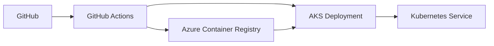

# Cloud-Native Delivery Engine

A CI/CD portfolio project for packaging a Flask microservice and deploying it to Azure Kubernetes Service (AKS). It demonstrates the path from source code to a containerized application.

## Architecture



## Implementation

- Flask exposes a service status endpoint and a health endpoint.
- Docker packages the application using a Python 3.9 slim base and Gunicorn.
- Kubernetes deployment defines two replicas, resource requests and limits, and HTTP liveness and readiness probes.
- The documented CI/CD design builds and publishes commit-tagged images to ACR before deploying to AKS.

## Run locally

```bash
python -m pip install -r requirements.txt
flask --app app run
```

Open http://127.0.0.1:5000/ and http://127.0.0.1:5000/health.

Alternatively:

```bash
docker build -t jobguard-engine .
docker run --rm -p 8080:80 jobguard-engine
```

## Deployment

Configure Azure credentials and registry access using GitHub Actions secrets. Replace IMAGE_PLACEHOLDER in the Kubernetes deployment with an accessible container image before applying it.

```bash
kubectl rollout status deployment/jobguard-app
kubectl get pods
```

If a rollout fails, inspect pod events and logs. Where a previous revision exists, use `kubectl rollout undo deployment/jobguard-app` and verify its health.

## Repository files

- [app.py](app.py): Flask service.
- [Dockerfile](Dockerfile): container build.
- [k8s/deployment.yaml](k8s/deployment.yaml): deployment and health probes.
- [GitHub Actions](https://github.com/sriramgg/Azure-Gitops-Engine/actions): pipeline history.

## Scope

This is a demonstration project, not a production service. Deployment timing, uptime and cloud costs depend on the environment. The Dockerfile currently uses a single-stage build.
